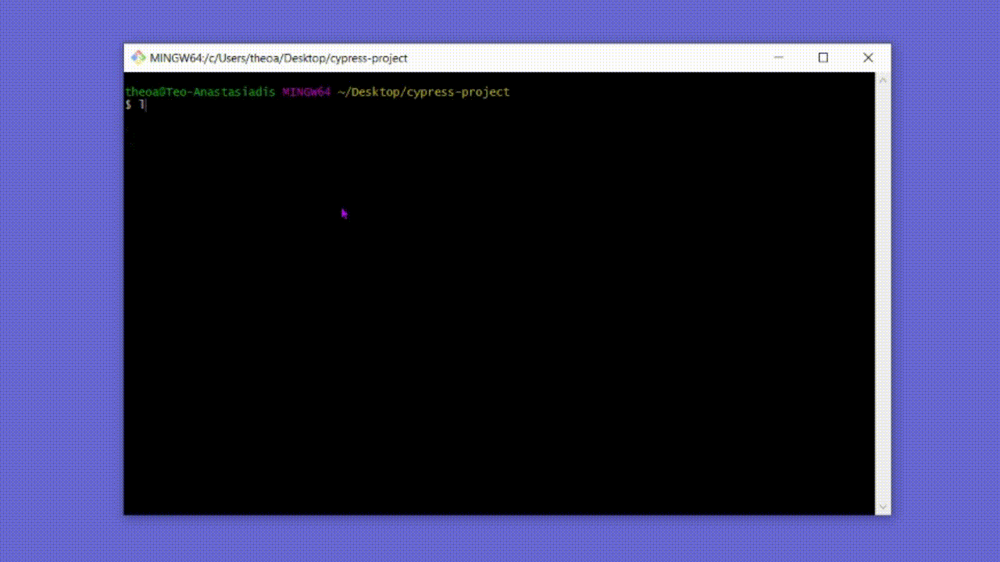

<p align="center">
  <a href="https://www.cypress.io">
    <picture>
      <source media="(prefers-color-scheme: dark)"  srcset="./assets/cypress-logo-dark.png">
      <source media="(prefers-color-scheme: light)" srcset="./assets/cypress-logo-light.png">
      
    </picture>
  </a>
</p>
<p align="center">
  <a href="https://on.cypress.io">Documentation</a> |
  <a href="https://on.cypress.io/changelog">Changelog</a> |
  <a href="https://www.cypress.io/roadmap">Roadmap</a>
</p>

<h3 align="center">
  AI writes the code. Cypress proves it works.
</h3>

<p align="center">
  Run end-to-end and component tests in a real browser and rewind any failure.<br />
  Works wherever you do: your machine, CI, or your coding agent.
</p>

<p align="center">
  <a href="https://www.npmjs.com/package/cypress"></a>
  <a href="https://www.npmjs.com/package/cypress"></a>
  <a href="https://github.com/cypress-io/cypress"></a>
  <a href="https://on.cypress.io/discord"></a>
  <a href="https://skills.sh/cypress-io/ai-toolkit"></a>
  <a href="https://github.com/cypress-io/cypress/blob/develop/LICENSE"></a>
</p>

## What is Cypress?

<p align="center">
  <a href="https://player.vimeo.com/video/237527670">
    
  </a>
</p>

## Installing

Install Cypress for Mac, Linux, or Windows, then [get started](https://on.cypress.io/install).

```bash
npm install cypress --save-dev
```
or
```bash
yarn add cypress --dev
```
or
```bash
pnpm add cypress --save-dev
```
or
```bash
bun add cypress --dev
```



### Add Cypress skills to your coding agent

Give your coding agent the [official Cypress skills](https://skills.sh/cypress-io/ai-toolkit) so it writes, runs, and debugs tests the Cypress way.

```bash
npx skills add cypress-io/ai-toolkit
```

## Community plugins

Extend Cypress with plugins built by the community and the Cypress team, covering everything from visual testing and accessibility to authentication and reporting. Browse the full list in the [plugins directory](https://docs.cypress.io/app/plugins/plugins-list).

## Contributing

[](https://cloud.cypress.io/projects/ypt4pf/runs)
[](https://circleci.com/gh/cypress-io/cypress/tree/develop) -  `develop` branch

Please see our [Contributing Guideline](./CONTRIBUTING.md) which explains repo organization, linting, testing, and other steps.

## License

[](https://github.com/cypress-io/cypress/blob/develop/LICENSE)

This project is licensed under the terms of the [MIT license](/LICENSE).

## Badges

Configure a badge for your project's README to show your test status or test count in the [Cypress Cloud](https://www.cypress.io/cloud).

[](https://cloud.cypress.io/projects/ypt4pf/runs)

[](https://cloud.cypress.io/projects/ypt4pf/runs)

Or let the world know your project is using Cypress with the badge below.

[](https://www.cypress.io/)

```
[](https://www.cypress.io/)
```
